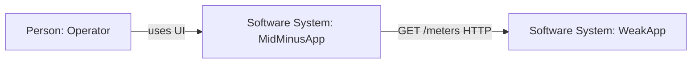
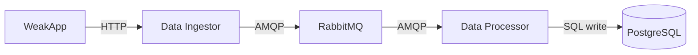
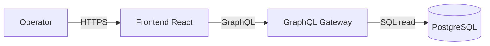
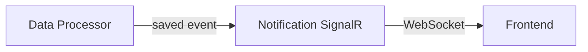
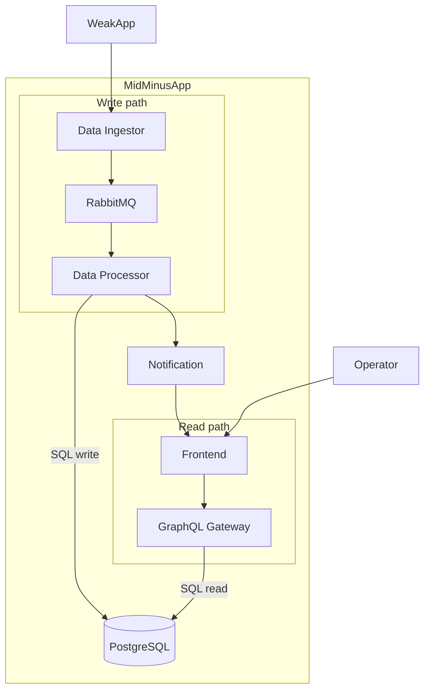
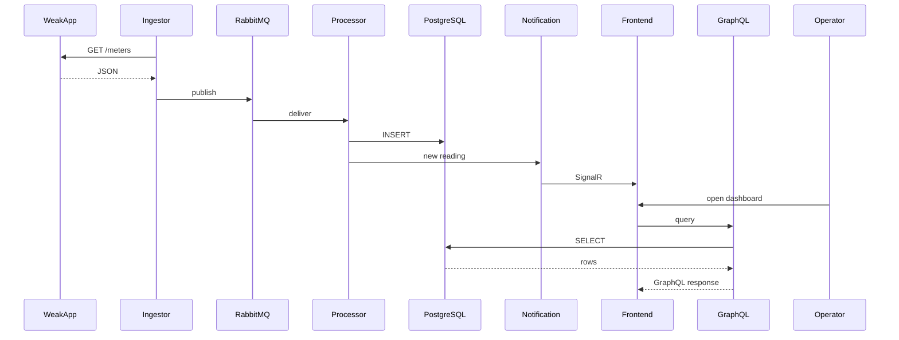
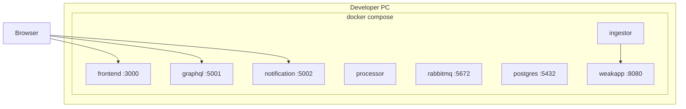

# MidMinusApp — C4 (обзор)

Архитектура **будущей** системы по [D3S1.docx](./D3S1.docx): Context → Container → Dynamic → Deployment.

**Software System в фокусе:** `MidMinusApp`.

---

## 1. System Context

| Участник | Роль |
|----------|------|
| **Operator** | Дашборды, графики, live-уведомления |
| **MidMinusApp** | Наша система (docker compose) |
| **WeakApp** | Внешний нестабильный API |

---

## 2. Container

### 2.1. Конвейер (WeakApp → БД)

### 2.2. UI (чтение из БД)

### 2.3. Real-time

### 2.4. Вся система

Два параллельных потока внутри границы MidMinusApp; связи между потоками — только через PostgreSQL, Notification и Frontend.

**Потоки:**

1. **Сбор:** WeakApp → Ingestor → RabbitMQ → Processor → PostgreSQL  
2. **UI:** Operator → Frontend → GraphQL → PostgreSQL  
3. **Live:** Processor → Notification → Frontend  

---

## 3. Dynamic (sequence)

---

## 4. Deployment (docker compose, dev)

